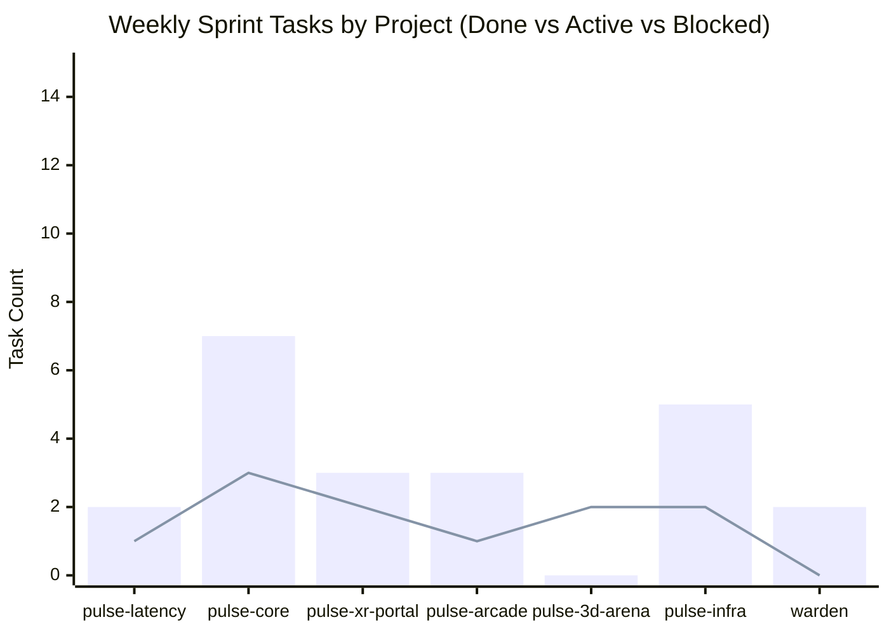
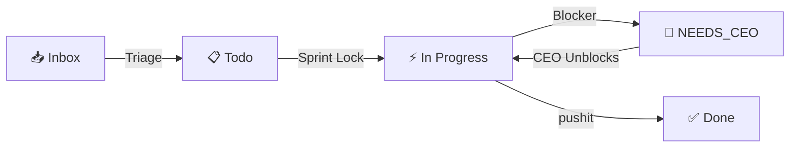

# Daily Standup MoM, Weekly Sprint Plan & Task Movements — `<YYYY-MM-DD>` (12:00 PM IST)

> **Chair**: `warden` (CEO Office Chief of Staff) & `cto` (Level 0 Head of Tech)
> **Project PMs & Leads (Level 1)**: `pm pulse-core` (`@pm:pulse-core`), `pm pulse-arcade` (`@pm:pulse-arcade`), `tech_lead pulse-core`, `tech_lead pulse-arcade`, `infra_head` (`pulse-infra`), `seo_aeo_head` (`marketing`)
> **Team Polled (Level 2)**: `backend_dev`, `frontend_dev`, `infra_jr`, `seo_content_dev`, `aeo_analyst`
> **Collated CTO Backlog**: [`worklist/COLLATED_BACKLOG.md`](../worklist/COLLATED_BACKLOG.md)
> **Session Chat Log**: [`chats/<YYYY-MM-DD>-session-<short-id>.md`](../chats/)
> **Active Sprint Week**: `<YYYY-WXX (Date Range)>`
> **Status**: `AWAITING_CEO_APPROVAL` | `APPROVED_EXECUTING` | `COMPLETED_AND_PUSHED`

---

## 1. Executive Summary & Visual Sprint Telemetry (ASD-STE100 + Tables + Diagrams)

### 1A. Executive Pulse Table
| Metric | Count / Value | Status | Action Required |
| :--- | :--- | :--- | :--- |
| **Tasks Shipped Since Last Standup** | `<N>` | `VERIFIED` | None |
| **Active Weekly Sprint Tasks (`P0`/`P1`)** | `<N>` | `IN_PROGRESS` | Approve sprint lock |
| **CEO Blockers (`[NEEDS_CEO]`)** | `<N>` | `BLOCKED` | Resolve items in Section 2 |
| **Board Transitions Today** | `<N>` | `SYNCED` | Review Section 4 ledger |

### 1B. Visual Sprint & Blocker Telemetry (`mermaid` + Generated Status Images)

---

## 🚨 2. Tasks Requiring CEO / Human Intervention (`[NEEDS_CEO]`)
> Added to project backlogs (`worklist/<project>/backlog.md`) and rolled up in [`worklist/COLLATED_BACKLOG.md`](../worklist/COLLATED_BACKLOG.md) whenever an agent needs a question answered (`QUESTION`), an API key/secret added (`API_KEY`), an external console/store action (`MANUAL_ACTION`), or a strategic approval (`DECISION`).

| Task ID | Priority | Project | Type (`QUESTION` / `API_KEY` / `MANUAL_ACTION` / `DECISION`) | Requested By | What Needs To Be Done / Answered by CEO | Unblocks Task |
| :--- | :--- | :--- | :--- | :--- | :--- | :--- |
| `<ID>` | `P0` | `<project>` | `<API_KEY / QUESTION / ...>` | `@<agent>` | `<Exact question, env var name, or manual step>` | `<Task ID>` |

---

## 🗓️ 3. What is Decided for the Week (`<YYYY-WXX>` Weekly Sprint Plan)
> Collated from `@pm:pulse-core`, `@pm:pulse-arcade`, `@infra_head`, and `@seo_aeo_head` project backlogs and visible to `@cto`.

### A. Project: `pulse-core` (PM: `@pm:pulse-core` | Tech Lead: `@tech_lead:pulse-core`)
| Task ID | Priority | Stage | Repo(s) | Weekly Deliverable & Acceptance Criteria | Assigned Executor |
| :--- | :--- | :--- | :--- | :--- | :--- |
| `DJ-...` | `P0` | `IN_PROGRESS` | `<repo>` | `<Deliverable>` | `@backend_dev:pulse-core` / `@frontend_dev:pulse-core` |

### B. Project: `pulse-arcade` (PM: `@pm:pulse-arcade` | Tech Lead: `@tech_lead:pulse-arcade`)
| Task ID | Priority | Stage | Repo(s) | Weekly Deliverable & Acceptance Criteria | Assigned Executor |
| :--- | :--- | :--- | :--- | :--- | :--- |
| `RW-...` | `P0` | `IN_PROGRESS` | `<repo>` | `<Deliverable>` | `@backend_dev:pulse-arcade` / `@frontend_dev:pulse-arcade` |

### C. Infrastructure & Cloud: `pulse-infra` (Lead: `@infra_head`)
| Task ID | Priority | Stage | Repo(s) | Weekly Deliverable & Acceptance Criteria | Assigned Executor |
| :--- | :--- | :--- | :--- | :--- | :--- |
| `INF-...` | `P0` | `IN_PROGRESS` | `pulse-infra` | `<Deliverable>` | `@infra_jr` |

---

## 🔄 4. Moving Around Tasks (Board Transitions & Re-Prioritizations)
> Every task moved across stages, priorities, or weekly buckets during this standup:

| Task ID | Project | Movement (`From -> To`) | Priority Change | Moved By | Reason / Context |
| :--- | :--- | :--- | :--- | :--- | :--- |
| `<ID>` | `<project>` | `INBOX -> TODO` | `-> P1` | `@pm:<project>` | Triaged from raw CEO inbox into project backlog |
| `<ID>` | `<project>` | `TODO -> IN_PROGRESS (This Week)` | `P1 -> P0` | `@cto` + `@pm:<project>` | Pulled into active weekly sprint plan |
| `<ID>` | `<project>` | `IN_PROGRESS -> NEEDS_CEO` | `P0` | `@<agent>` | Blocked on missing API key / CEO answer |
| `<ID>` | `<project>` | `IN_PROGRESS -> DONE` | `P0` | `@tech_lead:<project>` | Verified & shipped |

---

## 🤝 5. Cross-Team Dependencies & Handshakes
| Requesting Team | Providing Team | Dependency / Handoff | Target Resolution |
| :--- | :--- | :--- | :--- |
| `tech_lead (<project>)` | `infra_head` | `<e.g., GCS asset upload or Cloudflare Pages deploy>` | `<Today / Pre-deploy>` |

---

## 6. End-of-Standup Execution & Deployment Table *(Updated After CEO Approval)*
| Category | Repo / Scope | Status | Details & Commit Hash |
| :--- | :--- | :--- | :--- |
| **CEO Interventions Resolved** | `<project>` | `RESOLVED` | `<Keys added / Questions answered>` |
| **Code & Tests Verified** | `<repo>` | `PASSED` | `
` |
| **Deployments Run** | `<target>` | `LIVE` | `<CF Pages / GCS / pm2 deploy summary>` |
| **`pushit` Commits** | `<repo>` | `PUSHED` | `<Commit hash & version bump>` |
